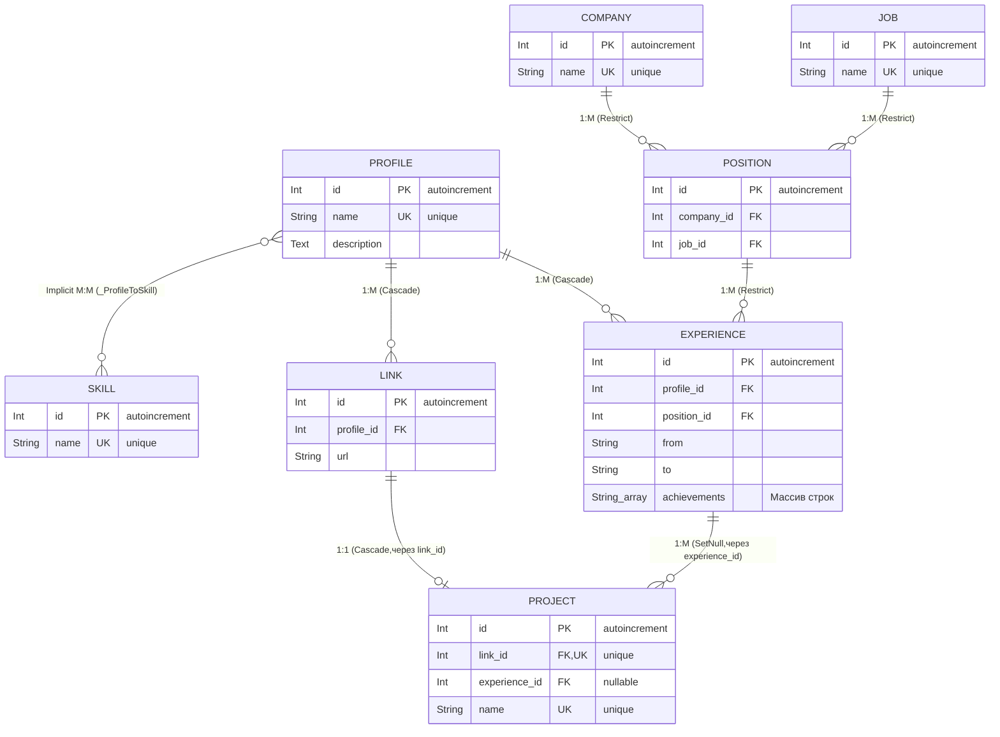

Итак, перед вами простой исследовательский проект визитки с одним контрактом на базе следующих технологий:

- Git;

- TypeScript;

- Node.js;

- NestJS;

- Prisma;

- GraphQL;

- Docker.


> [!WARNING]
> #### Проект развёрнут на `SnapShot + Supabase (СУБД)`: https://employee-digital-card-217c7.containers.snapdeploy.app/api/graphql
> #### NB! Необходимо подождать порядка 2-х минут, чтобы сервис "проснулся" и потворить запрос ещё раз - данность бесплатной версии.


## Структура API:


### Контракт "Получить визитную карточку"

#### Структура запроса:

```javascript

query {
  profile(id: <number>) {
    id
    name
    description
    skills
    links {
      id
      url
      provider
    }
    projects {
      id
      name
      url
      company
    }
    experience {
      id
      company
      position
      period  # Возвращает весь JSON-объект целиком без вложенных селекторов
      achievements
    }
  }
}
```

#### Ответ:


```json
{
  "data": {
    "profile": {
      "id": "string (ID / уникальный ключ)",
      "name": "string (ФИО разработчика)",
      "description": "string | null (Краткое резюме)",
      "skills": [
        "string (Технический тег/навык)",
        "string",
        ...
      ],
      "links": [
        {
          "id": "string (ID связи)",
          "url": "string (Абсолютный URL ресурса)",
          "provider": "string | null (Вычисляемое имя хоста)"
        },
        ...
      ],
      "projects": [
        {
          "id": "string (ID проекта)",
          "name": "string (Название проекта)",
          "url": "string (Ссылка на репозиторий/демо)",
          "company": "string | null (Компания привязки опыта)"
        },
        ...
      ],
      "experience": [
        {
          "id": "string (ID записи опыта)",
          "company": "string (Название работодателя - название организации)",
          "position": "string (Занимаемая должность)",
          "period": {
            "from": "string (Дата начала)",
            "to": "string | null (Дата окончания или null для наст. времени)"
          },
          "achievements": [
            "string (Описание выполненной задачи / достижения)",
            "string",
            ...
          ]
        },
        ...
      ]
    }
  }
}
```

#### Данные визитки (профиля) по связанным объектам в виде списков:

 - skills - список скалярных значений в виде текста

 - links

 - projects

 - experience

##### Опыт работы `experience`:

* `achievements` установлен в виде списка пунктов. Это всё, что пишет пользователь в свободной форме в 
рамках одного опыта, поэтому реализован в виде списка как один результат. Получать какое-то отдельное 
достижение, задавая ему id избыточно. Это не бизнес-объект.

* `period` в структуре ответа установлен как единое json-значение, как один результат для удобства чтения.
Получать его данные частично не имеет смысла. Это тоже не бизнес-объект, а часть сущности.


## Архитектура.

DDD для обеспечения единообразия, лучшей поддержки кода и масштабируемости.

СУБД: PostgreSQL. Очень быстрая СУБД с поддержкой понятной индексации. Обеспечивает 
построение реляционной модели совмещая нативные возможности представления json-данных и списков, 
где это требуется.



#### Дополнительно реализовано:

На инфраструктурном уровне в коде репозитория реализовано средство построения sql-запроса в виде 
сырого sql.

Я отказался полагаться на возможности orm Prisma, поскольку в реляционной модели и в принятой
схеме отношений нельзя избежать проблемы N + 1, сделав "один" запрос на уровне orm, чтобы
вытащить все связанные с основным объектом данные.
Поэтому я разработал единый шаблон, строящий sql и запрашивающий данные через безопасность, 
реализованную в сыром методе запроса Prisma. 

Запрос строится только по верхним ключам, что указывает пользователь api и которые соответствуют 
тем данным, что получаются в результате объединений соотвествующим им таблиц.


В классе репозитория PrismaProfileRepository заданы необходимые установки:

- структура `metaSql` (настройки построения sql-запроса для получения всех требуемых данных)

- метод `findById` (алгоритм построения sql-запроса и получения объекта)

Структура `metaSql` представляет собой объект `SQLMetadata` с полями в json-данных api, в которых
есть две установки:

 - `fc_sql` - (от `field clauses`) какие поля нужны

 - `join_sql` - выражение по объединению таблиц чтобы данные получить

Алгоритм берёт поле `objectFieldsClauses` с перечислением полей и строит выражение SELECT по
главному объекту.

Далее идёт цикл по набору `uFields`. Это то, что задал пользователь в запросе как поля самого 
верхнего уровня, данные которых он хочет получить.
На каждой итерации, после проверки присутствия поля из `uFields` в структуре `sqlParts`, заданные для
него поля данных применяются к SELECT в начале запроса и в конец пристыковываются JOIN выражения.
После цикла по каждому полю из запроса присоединяется хвостовое выражение по каким полям 
(первичный ключ) ищем основной объект.

Таким образом, избегается избыточность запроса - мы получаем данные только те, которые запросил 
пользователь. Но для этого нужно уметь задавать сложные join-объединения. Но, за счёт исключения 
лишних запросов N + 1 повышается производительность. 

`metaSql`:

```javascript
{ 
    objectFieldsClauses: 'table*.', // перечисление на SQL полей основного объекта 
    sqlParts: {
        <json_поле_связанных_объектов>: {
            fc_sql: 'table.field AS sfield, ...',// перечисление на SQL полей связанного объекта 
            join_sql: `
                    OUTER | 
                    INNER | 
                    LEFT  | 
                    RIGHT | 
                    FULL 
                    JOIN table_2 t2 ON table.field = t2.field_fk
                    `// последовательность выражений для соединения таблиц, чтобы получить необходимые данные
            },
        ...
      },
    tail: 'WHERE table.pk = $1 ORDER BY pk' //хвостовой предикат выражения (по какому условию ищем основной объект)
}
```

Исходник:
infrastructure/data-access/prisma/repository.impl.ts